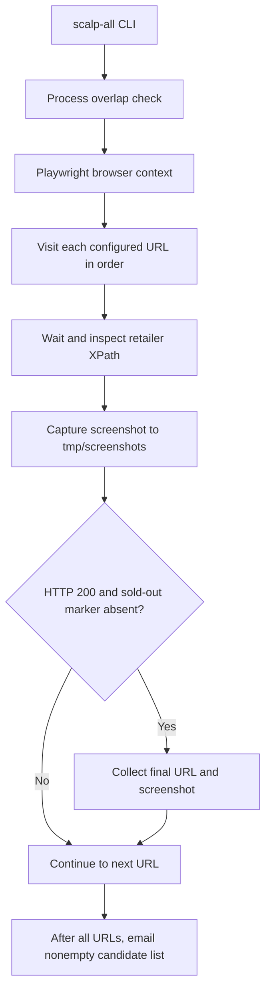

# goods-scalper

A 2021 TypeScript experiment that checks configured retailer pages for possible PlayStation 5 availability and sends email notifications with screenshots. Purchases are manual. The project is inactive, and retailer rules have not been verified against current websites.

## How it works



Rules live in `src/config/config.ts`: seven active URLs across six retailers, each with an XPath expression identifying an out-of-stock message. Navigation failures are logged and skipped. Candidates are heuristic results, not confirmed purchasable stock. There is no discovery of new product URLs, checkout automation, or alert deduplication.

## Local setup and usage

The implementation uses Node.js, npm, TypeScript, Playwright, SendGrid, Commander, Winston, and Rollbar. The historical Docker image uses Node 15; a currently supported runtime has not been validated. These steps are derived from source and have not been executed as part of the repository analysis.

1. Clone the repository and enter its directory:

   ```bash
   git clone git@github.com:tuumbleweed/goods-scalper.git
   cd goods-scalper
   ```

2. Copy `.env.example` to `.env` and replace the placeholders. Startup currently requires **all** variables checked by `src/util/secret.ts`, including unrelated starter database and API settings. Configure SendGrid credentials and recipient; update the hardcoded sender in `src/lib/email.ts` to an authorized sender before sending mail. Verbose/debug logging can expose secrets, so review the logging code before using real credentials.

3. Review `src/config/config.ts`: update URLs and selectors, and provide Chrome at the configured `/usr/bin/google-chrome` path or adjust `executablePath`. The CLI lists Chromium, Firefox, and WebKit options, but the fixed Chrome path means these are not validated interchangeable configurations.

4. Install and compile:

   ```bash
   npm i
   npm run build
   ```

   Compilation outputs to `dist/`.

5. From the repository root, run a one-shot headless check:

   ```bash
   npm run scalp-all -- --headless
   ```

   For CLI help:

   ```bash
   npm run scalp-all -- --help
   ```

   The script writes screenshots under `tmp/screenshots/` and logs under `log/`. It sends one email only if the candidate list is nonempty. `--incognito` is declared but currently wired to the wrong setting; the launcher uses a persistent browser context by default.

## Development

```bash
npm run watch-ts
npm run lint
```

`watch-ts` rebuilds on changes. `lint` performs a TypeScript check and runs ESLint with `--fix`, which can modify files. `npm test` is declared, but `test/` contains no implemented tests.

`run-once.sh` accepts the project directory and Node executable path and invokes the headless monitor. It was introduced for cron, but no schedule is tracked. It also passes the currently ineffective `--incognito` flag. An installed schedule must be configured separately; its historical cadence is unknown.

## Starter components

The repository retains an Express example API, PostgreSQL/Redis helpers, Docker configuration, and an Ubuntu 20.04 provisioning script from a TypeScript starter. These are not required services for the monitoring path, although startup still validates their environment variables. For development of those example components, the original service command is:

```bash
docker-compose up db redis
```

This requires Docker and the legacy `docker-compose` command expected by the checked-in configuration. Compose does not define a stock-monitor service. The provisioning script still targets the starter repository and expects an absent `cronfile`; it is not a complete monitor installation procedure.

The original README's `build/` output path and `your-script` example are corrected above. Its machine-level Docker installation instructions and broad starter-container/volume deletion pipeline are omitted because they are not a monitor-specific setup or safe project-specific cleanup procedure.
