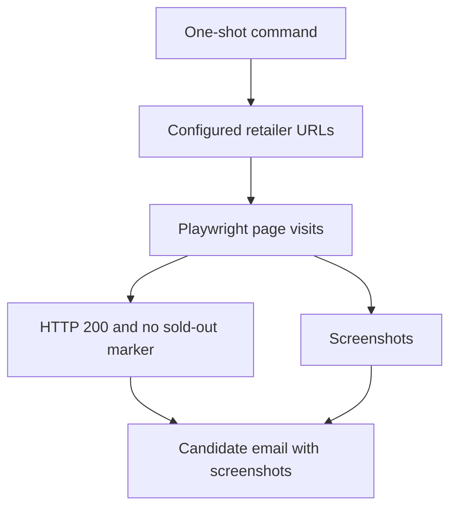

# goods-scalper

## Overview

A personal experiment for monitoring possible PlayStation 5 availability during the 2021 shortage. It visits configured retailer pages and emails candidate links with screenshots for manual review and purchase.

## My Contributions

The project-specific work adds Playwright browser automation to a TypeScript starter: retailer-specific XPath rules, sequential page checks, screenshot capture, SendGrid alerts, a wrapper intended for cron, and an existing process-check helper integrated to discourage overlapping runs. The starter's example API, PostgreSQL, and Redis utilities are separate from the monitoring workflow.

## Architecture

## Technical Challenges

Retailers use different sold-out messages, so each configured page has its own XPath rule. A later change restricts alerts to HTTP 200 responses. Screenshots provide context for checking the heuristic's results; missing sold-out text alone does not establish stock availability. Each run collects candidates before sending one email.

## Results and Current State

The repository implements a one-shot monitoring and notification pipeline with seven configured URLs across six retailers. It has no automated checkout or product-page discovery, and contains no implemented tests or retained runtime results. The owner recalls receiving some detections but reports that this method did not result in buying a PS5. That outcome is personal recollection rather than a measured repository result. The experiment is inactive; present-day retailer compatibility has not been verified.

## Development History

Observed Git activity spans May 9–13, 2021. Browser checks, email attachments, and the cron-oriented wrapper appeared on May 9. Subsequent commits revised retailer rules, filtered non-200 responses, and integrated overlap prevention. These dates describe the available commits, not a verified operating period.
